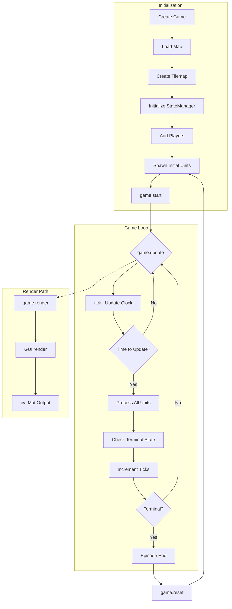
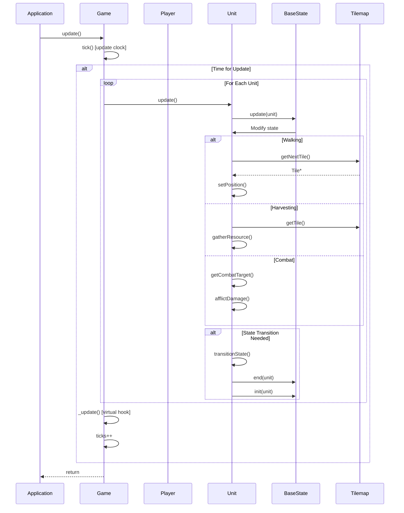
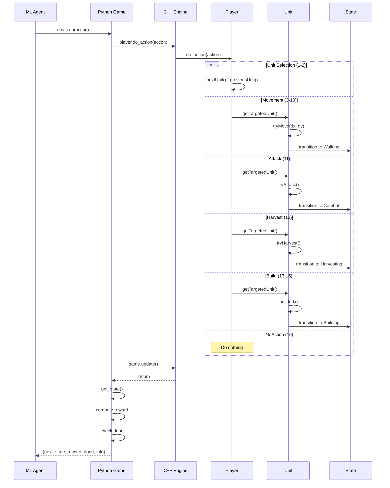
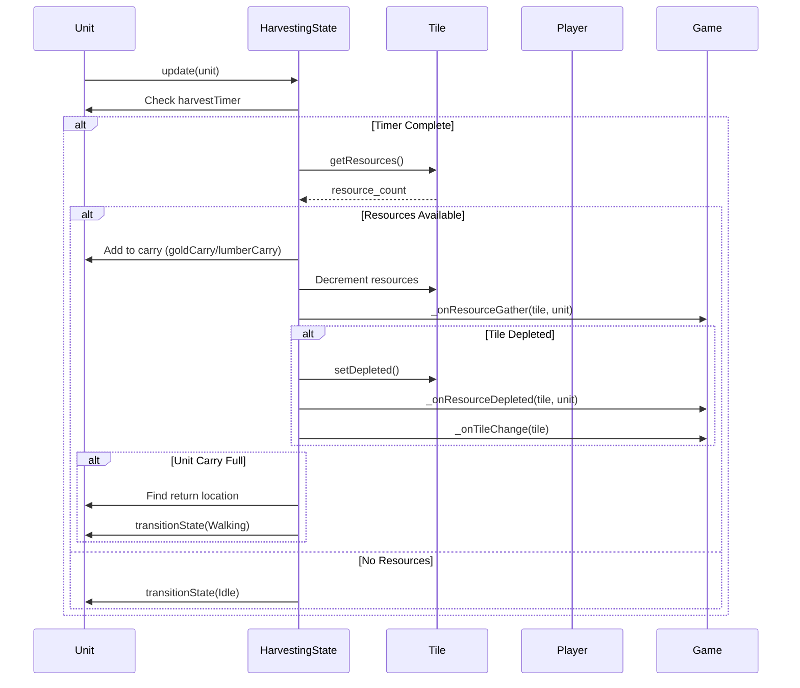
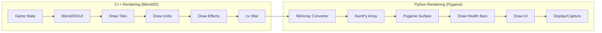
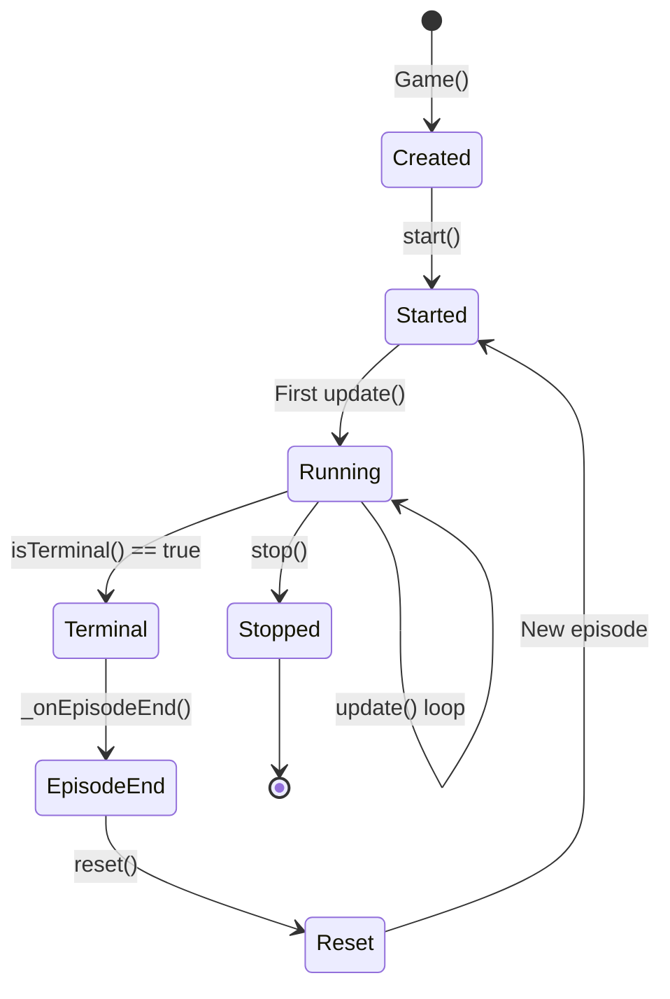

# Data Flow

> Game loop execution, data flow, and sequence diagrams.

## Main Game Loop



## Frame Update Sequence



## Action Processing Flow



## Resource Harvesting Flow



## State Observation Format

The game state is an xtensor array with shape `(width, height, 10)`:

```
State Tensor: (W x H x 10)
├── Channel 0: Tile type ID
├── Channel 1: Tile walkability
├── Channel 2: Tile resources remaining
├── Channel 3: Unit presence (unit ID or -1)
├── Channel 4: Unit type
├── Channel 5: Unit owner (player ID)
├── Channel 6: Unit health
├── Channel 7: Unit state
├── Channel 8: Reserved
└── Channel 9: Reserved
```

## Rendering Pipeline



## Episode Lifecycle



## Data Flow Between Layers

```
┌─────────────────────────────────────────────────────────────┐
│                     Python Layer                             │
│  ┌─────────┐    ┌─────────┐    ┌─────────┐    ┌─────────┐  │
│  │  Agent  │───▶│env.step │───▶│get_state│───▶│  Model  │  │
│  └─────────┘    └─────────┘    └─────────┘    └─────────┘  │
│       │              │              ▲                        │
│       │         action (int)        │ np.ndarray             │
│       │              │              │                        │
└───────┼──────────────┼──────────────┼────────────────────────┘
        │              │              │
        │              ▼              │
┌───────┼────────────────────────────┼─────────────────────────┐
│       │        Binding Layer       │                         │
│       │    ┌───────────────────────┴───┐                     │
│       │    │ xtensor ←→ numpy converter │                     │
│       │    └───────────────────────────┘                     │
│       │              │                                       │
└───────┼──────────────┼───────────────────────────────────────┘
        │              │
        │              ▼
┌───────┼──────────────────────────────────────────────────────┐
│       │          C++ Engine Layer                            │
│       ▼                                                      │
│  ┌─────────┐    ┌─────────┐    ┌─────────┐                  │
│  │do_action│───▶│ update  │───▶│  state  │                  │
│  └─────────┘    └─────────┘    └─────────┘                  │
│                      │              │                        │
│                      ▼              │                        │
│                ┌─────────┐          │                        │
│                │ render  │          │                        │
│                └─────────┘          │                        │
│                      │              │                        │
│                cv::Mat              │ xt::xarray             │
└──────────────────────┴──────────────┴────────────────────────┘
```
