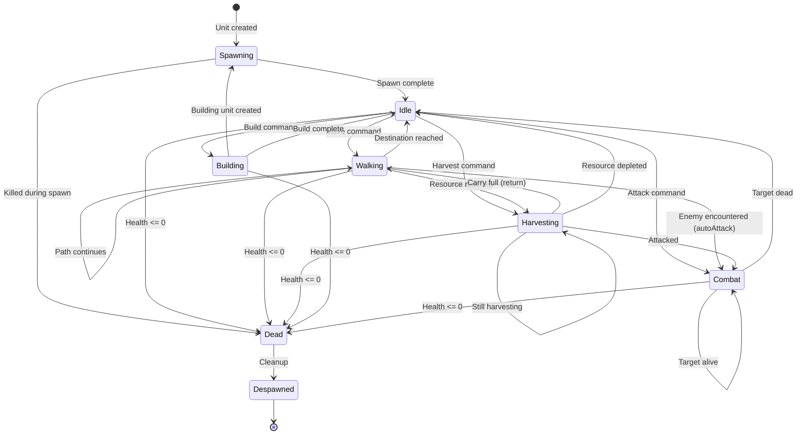

# Unit State Machine

> Complete specification of unit behavior states and transitions.

## State Overview

Units in DeepRTS use a finite state machine to manage behavior. Each unit has exactly one active state at any time.



## State Details

### Spawning (`include/DeepRTS/state/Spawning.h`)

**Purpose**: Handles unit creation delay.

| Property | Description |
|----------|-------------|
| Duration | Configurable via `unit.spawnDuration` |
| Interruptible | Yes (can be killed) |
| Exit Condition | Timer expires |

```cpp
void Spawning::update(Unit& unit) {
    unit.spawnTimer++;
    if (unit.spawnTimer >= unit.spawnDuration) {
        unit.transitionState(idle);
    }
}
```

### Idle (`include/DeepRTS/state/Idle.h`)

**Purpose**: Default waiting state when no action is pending.

| Property | Description |
|----------|-------------|
| Duration | Indefinite |
| Interruptible | Yes |
| Exit Condition | Any player command |

**Behavior**:
- Unit stands ready
- Responds to commands immediately
- Auto-attack if enemy in range and `config.autoAttack = true`

### Walking (`include/DeepRTS/state/Walking.h`)

**Purpose**: Movement using A* pathfinding.

| Property | Description |
|----------|-------------|
| Duration | Path-dependent |
| Interruptible | Yes |
| Speed | `unit.walking_interval` (modified by tile walkModifier) |

**Behavior**:
- Uses A* via `Pathfinder::aStar()`
- Handles 8-directional movement
- Updates unit direction for animation
- Can transition to Combat if `autoAttack` finds enemy

```cpp
void Walking::update(Unit& unit) {
    unit.walking_timer++;
    
    if (unit.walking_timer >= unit.walking_interval) {
        Tile* nextTile = unit.getNextTile();
        if (nextTile) {
            unit.setPosition(*nextTile);
            unit.walking_timer = 0;
        } else {
            unit.transitionState(idle);
        }
    }
}
```

### Harvesting (`include/DeepRTS/state/Harvesting.h`)

**Purpose**: Resource gathering from tiles.

| Property | Description |
|----------|-------------|
| Duration | Until full or depleted |
| Interruptible | Yes |
| Interval | `unit.harvestInterval` |

**Resource Flow**:
1. Unit moves to harvestable tile
2. Periodically extracts resources
3. Adds to `unit.goldCarry`, `lumberCarry`, or `stoneCarry`
4. When full, walks to Town Hall to deposit
5. Returns to continue if `config.harvestForever`

```cpp
void Harvesting::update(Unit& unit) {
    unit.harvestTimer++;
    
    if (unit.harvestTimer >= unit.harvestInterval) {
        Tile* tile = unit.getTile(unit.harvestTargetID);
        
        if (tile && tile->getResources() > 0) {
            float yield = /* calculate based on resource type */;
            unit.addCarry(tile->getResourceType(), yield);
            tile->decrementResources(1);
            
            if (unit.isCarryFull()) {
                // Return to base
                unit.transitionState(walking);
            }
        } else {
            unit.transitionState(idle);
        }
        
        unit.harvestTimer = 0;
    }
}
```

### Combat (`include/DeepRTS/state/Combat.h`)

**Purpose**: Attack behavior against enemy units.

| Property | Description |
|----------|-------------|
| Duration | Until target dead or out of range |
| Interruptible | Yes |
| Interval | `unit.combatInterval` |

**Damage Calculation**:
```cpp
int Unit::getDamage(Unit& target) const {
    int damage = Random::get(damageMin, damageMax);
    damage += damagePiercing;
    damage -= target.armor;
    return std::max(1, damage);  // Minimum 1 damage
}
```

**Behavior**:
1. Check target in range (`damageRange`)
2. Apply damage at `combatInterval`
3. Trigger `Game::_onUnitAttack`
4. Update statistics (`sDamageDone`, `sDamageTaken`)
5. Target dies → transition to Idle

### Building (`include/DeepRTS/state/Building.h`)

**Purpose**: Construction of structures.

| Property | Description |
|----------|-------------|
| Duration | Configurable (instant if `config.instantBuilding`) |
| Interruptible | Yes |
| Cost | Unit-specific (gold, lumber, stone) |

**Build Inventory** (per unit type):
| Builder | Build0 | Build1 | Build2 |
|---------|--------|--------|--------|
| Peasant | Town Hall | Farm | Barracks |

**Behavior**:
1. Check resource requirements
2. Deduct costs from player
3. Create building entity at adjacent tile
4. Builder enters Building state
5. Building spawns in Spawning state

### Dead (`include/DeepRTS/state/Dead.h`)

**Purpose**: Handle unit destruction.

**Behavior**:
1. Trigger `Game::_onUnitDestroy`
2. Update player unit counts
3. Clear tile occupancy
4. Mark for removal

### Despawned (`include/DeepRTS/state/Despawned.h`)

**Purpose**: Final cleanup before removal.

**Behavior**:
1. Set `unit.removedFromGame = true`
2. Remove from player's unit list
3. Remove from name map

## State Transition API

```cpp
// Direct transition
unit.transitionState(std::shared_ptr<BaseState> nextState);

// Queue-based transition (for complex sequences)
unit.enqueueState(std::shared_ptr<BaseState> state);

// StateManager provides state singletons
stateManager.getState(Constants::State::Idle);
stateManager.getState(Constants::State::Walking);
```

## State Constants

**Source**: [include/DeepRTS/Constants.h](../include/DeepRTS/Constants.h)

```cpp
enum State {
    Spawning = 1,
    Walking = 2,
    Despawned = 3,
    Harvesting = 4,
    Building = 5,
    Combat = 6,
    Dead = 7,
    Idle = 8,
    Base = -1  // Abstract base
};
```

## Animation Integration

States drive animation through `unit.direction`:

```cpp
enum Direction {
    Down = 1,
    Up = 2,
    Left = 3,
    Right = 4,
    DownLeft = 5,
    DownRight = 6,
    UpLeft = 7,
    UpRight = 8
};
```

Animation frames are selected based on:
- Current state (Idle, Walking, Combat, etc.)
- Direction
- Animation counter (`unit.animationCounter`)

## Configuration Impact

| Config Option | Affected States |
|---------------|-----------------|
| `instantBuilding` | Building (skip duration) |
| `instantTownHall` | Building (auto-build on spawn) |
| `harvestForever` | Harvesting (continuous loop) |
| `autoAttack` | Walking, Idle (auto-transition to Combat) |
| `animationEnabled` | All (disable counter updates for perf) |
