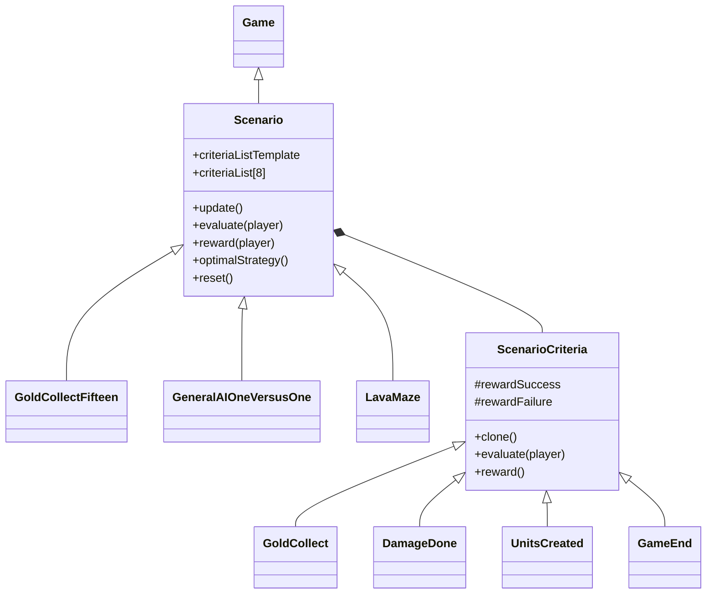
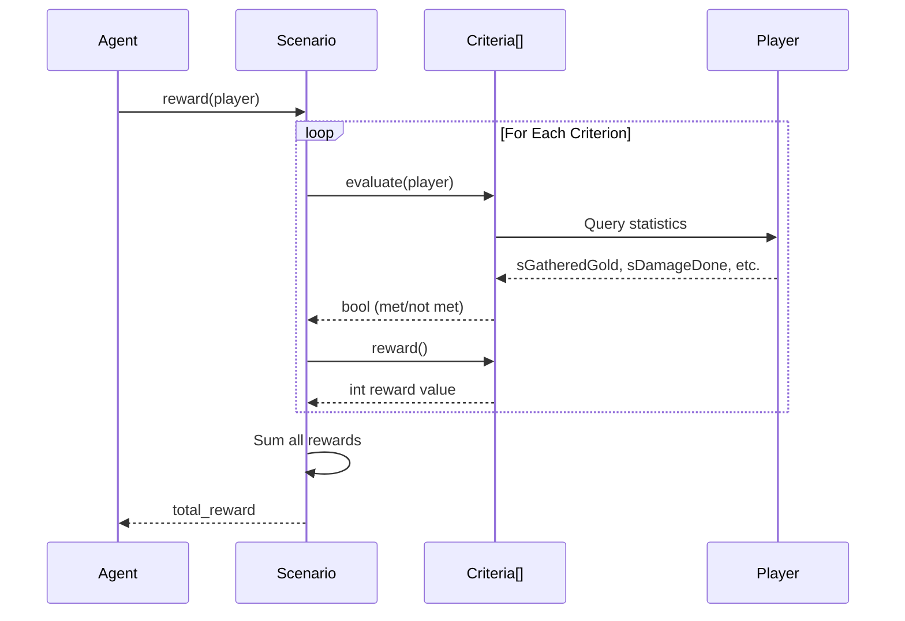
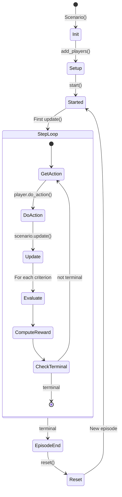

# Scenario System

> Training scenarios, criteria, and reward configuration.

## Overview

Scenarios are pre-built training environments that extend the base `Game` class with:
- Predefined map and configuration
- Custom reward criteria
- Evaluation logic for episode termination
- Optional optimal strategy computation

## Architecture



## Built-in Scenarios

### GoldCollectFifteen

**Source**: [include/DeepRTS/scenario/scenarios/GoldCollectFifteen.h](../include/DeepRTS/scenario/scenarios/GoldCollectFifteen.h)

| Property | Value |
|----------|-------|
| **Map** | 15x15-2p-ffa-Cresal |
| **Objective** | Collect 1000 gold |
| **Players** | 1-2 |
| **Difficulty** | Easy (training wheels) |

**Default Criteria**:
- `GoldCollect(1000, reward_success, reward_failure)`

### GeneralAIOneVersusOne

**Source**: [include/DeepRTS/scenario/scenarios/GeneralAIOneVersusOne.h](../include/DeepRTS/scenario/scenarios/GeneralAIOneVersusOne.h)

| Property | Value |
|----------|-------|
| **Map** | 31x31-2p-ffa-Thelor |
| **Objective** | Defeat opponent |
| **Players** | 2 |
| **Difficulty** | Full game |

**Default Criteria**:
- `GameEnd(reward_success, reward_failure)`
- `DamageDone(threshold, reward_success, reward_failure)`

### LavaMaze

**Source**: [include/DeepRTS/scenario/scenarios/LavaMaze.h](../include/DeepRTS/scenario/scenarios/LavaMaze.h)

| Property | Value |
|----------|-------|
| **Map** | 15x15-1p-ffa-Utha-Lava |
| **Objective** | Navigation/survival |
| **Players** | 1 |
| **Difficulty** | Specialized |

## Criteria System

### Base Criteria Interface

**Source**: [include/DeepRTS/scenario/criterias/ScenarioCriteria.h](../include/DeepRTS/scenario/criterias/ScenarioCriteria.h)

```cpp
class ScenarioCriteria {
protected:
    const int rewardSuccess;
    const int rewardFailure;
    
public:
    ScenarioCriteria(int rewardSuccess = 0.01, int rewardFailure = -0.01);
    
    virtual std::shared_ptr<ScenarioCriteria> clone() const = 0;
    virtual bool evaluate(const Player& player) = 0;
    virtual int reward() const = 0;
};
```

### Available Criteria

| Criteria | Parameters | Evaluation |
|----------|------------|------------|
| **GoldCollect** | `threshold` | `player.sGatheredGold >= threshold` |
| **LumberCollect** | `threshold` | `player.sGatheredLumber >= threshold` |
| **StoneCollect** | `threshold` | `player.sGatheredStone >= threshold` |
| **DamageDone** | `threshold` | `player.sDamageDone >= threshold` |
| **DamageDoneIncrement** | - | Reward per damage increment |
| **DamageTaken** | `threshold` | `player.sDamageTaken >= threshold` |
| **DamageTakenIncrement** | - | Penalty per damage increment |
| **UnitsCreated** | `threshold` | `player.sUnitsCreated >= threshold` |
| **UnitIncrement** | - | Reward per unit created |
| **NumUnitTypeCreated** | `unitType, count` | Specific unit type count |
| **FoodConsumption** | `threshold` | Food consumption target |
| **FoodCount** | `threshold` | Food available target |
| **ResourceIncrement** | - | Reward per resource increment |
| **GameEnd** | - | Episode terminal detection |

## Creating Custom Scenarios

### C++ Definition

```cpp
#include <scenario/Scenario.h>
#include <scenario/criterias/GoldCollect.h>

class MyScenario : public DeepRTS::Scenarios::Scenario {
public:
    MyScenario() : Scenario(
        "21x21-2p-ffa-Eflines.json",  // Map
        Config::defaults(),             // Config
        {
            std::make_shared<GoldCollect>(500, 1, -1),
            std::make_shared<DamageDone>(100, 1, 0)
        }
    ) {}
};
```

### Python Usage

```python
from DeepRTS import Engine

# Using built-in scenario
scenario = Engine.scenario.GoldCollectFifteen()
player0 = scenario.add_player()
player1 = scenario.add_player()
scenario.start()

while not scenario.is_terminal():
    player0.do_action(action)
    scenario.update()
    
    reward = scenario.reward(player0)
    done = scenario.evaluate(player0)
```

### Custom Criteria in Python

```python
from DeepRTS.Engine.scenario.criteria import ScenarioCriteria

class CustomCriteria(ScenarioCriteria):
    def __init__(self, target_score):
        super().__init__(reward_success=10, reward_failure=-1)
        self.target = target_score
    
    def clone(self):
        return CustomCriteria(self.target)
    
    def evaluate(self, player):
        return player.get_score() >= self.target
    
    def reward(self):
        return self.rewardSuccess if self._met else self.rewardFailure
```

## Reward Computation

### Per-Step Reward

```python
def step(self, action):
    self.player.do_action(action)
    self.scenario.update()
    
    # Aggregate rewards from all criteria
    reward = self.scenario.reward(self.player)
    
    # Check terminal conditions
    done = self.scenario.evaluate(self.player) or self.scenario.is_terminal()
    
    return self.get_state(), reward, done, {}
```

### Reward Flow



## Episode Lifecycle with Scenarios



## Configuration for Scenarios

| Config | Impact on Scenarios |
|--------|---------------------|
| `instantTownHall` | Speeds up early game |
| `instantBuilding` | Faster construction |
| `harvestForever` | Affects resource criteria |
| `foodLimit` | Unit production limits |
| `autoAttack` | Combat scenario dynamics |
| `terminalSignal` | Enable/disable game-over detection |

## Optimal Strategy API

For scenarios with known solutions:

```python
# Get sequence of optimal actions
strategy = scenario.optimal_strategy()
# Returns: [(Action, "description"), ...]

# Execute one optimal step
action, reward, done = scenario.optimal_play_game_step(player)

# Compute optimal action
action, expected_reward, is_terminal = scenario.compute_optimal_strategy(player)
```

This is useful for:
- Baseline comparison
- Imitation learning
- Curriculum design
