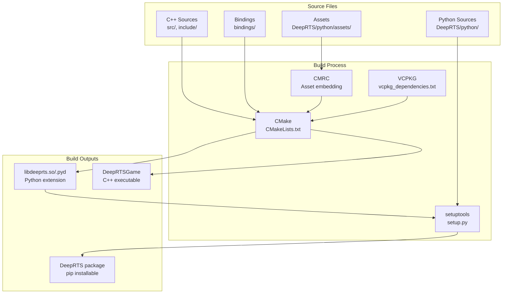
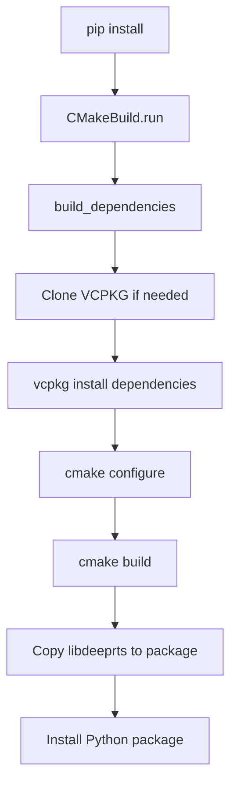

# Build System

> Complete build pipeline, dependencies, and troubleshooting.

## Build Architecture



## Installation Methods

### Method 1: pip install from Git

```bash
pip3 install git+https://github.com/cair/DeepRTS.git
```

**Pros**: Simplest, handles everything
**Cons**: Slow first build, needs build tools

### Method 2: Clone and Install

```bash
git clone --recurse-submodules https://github.com/cair/deep-rts.git
cd deep-rts
pip3 install .
```

### Method 3: Development Install

```bash
git clone --recurse-submodules https://github.com/cair/deep-rts.git
cd deep-rts
pip3 install -e .
```

**Note**: `-e` enables editable mode for Python changes but C++ still needs rebuild.

### Method 4: C++ Only Build

```bash
mkdir build && cd build
cmake .. -DPYTHON_BUILD=OFF
make -j$(nproc)
```

## CMake Configuration

**Source**: [CMakeLists.txt](../CMakeLists.txt)

### Key Variables

| Variable | Default | Description |
|----------|---------|-------------|
| `PYTHON_BUILD` | OFF | Build Python bindings |
| `IS_PYBIND_BUILD` | OFF | PyBind11 build mode |
| `LIBRARY_TYPE` | STATIC | Static or shared library |
| `BUILD_DOCS` | OFF | Generate Doxygen docs |
| `ENABLE_LOCK` | ON | CMake lock for parallel builds |

### Build Targets

| Target | Description |
|--------|-------------|
| `libdeeprts` | Python extension module |
| `DeepRTSLib` | Static C++ library |
| `DeepRTSGame` | Standalone C++ executable |
| `DeepRTSAssets` | Embedded assets library |
| `doc_doxygen` | Documentation |

## VCPKG Dependencies

**Source**: [vcpkg_dependencies.txt](../vcpkg_dependencies.txt)

```
spdlog
effolkronium-random
xtensor[xsimd]
nlohmann-json
opencv
blend2d
pybind11
```

### VCPKG Integration

The build uses PMM (Package Manager Manager) for VCPKG:

```cmake
include(cmake/pmm.cmake)

pmm(
    VERBOSE
    DEBUG
    VCPKG
    REVISION 2023.04.15
    REQUIRES ${DEEPRTS_DEPENDENCIES}
    TRIPLET ${VCPKG_TARGET_TRIPLET}
)
```

## Setup.py Process

**Source**: [setup.py](../setup.py)



### Custom CMake Build Class

```python
class CMakeBuild(build_ext):
    def build_extension(self, ext):
        # Configure with Python-specific flags
        cmake_args = [
            f'-DPYTHON_BUILD=ON',
            f'-DPYTHON_EXECUTABLE={sys.executable}',
            # ... more flags
        ]
        
        # Build
        subprocess.check_call(['cmake', '--build', '.'])
```

## Asset Embedding

**Technology**: CMRC (CMake Resource Compiler)

**Source**: [cmake/CMakeRC.cmake](../cmake/CMakeRC.cmake)

```cmake
FILE(GLOB_RECURSE deeprts_assets 
    RELATIVE ${PROJECT_SOURCE_DIR} 
    DeepRTS/python/assets/*)

cmrc_add_resource_library(DeepRTSAssets 
    ALIAS deeprts::assets
    WHENCE DeepRTS/python
    ${deeprts_assets}
)
```

**Embedded Assets**:
- Maps (`*.json`)
- Textures (`*.png`)
- Tile properties
- Audio files
- Fonts

## Platform-Specific Notes

### Linux (x86_64)

```bash
# Build dependencies
sudo apt install build-essential cmake ninja-build python3-dev

# VCPKG triplet
VCPKG_TARGET_TRIPLET=x64-linux
```

### macOS (x86_64 / arm64)

```bash
# Build dependencies
brew install cmake ninja

# Deployment target auto-detected from sw_vers
CMAKE_OSX_DEPLOYMENT_TARGET=$(sw_vers -productVersion)
```

### Windows (x64)

```bash
# VCPKG triplet
VCPKG_TARGET_TRIPLET=x64-windows

# Optimizations
OPTIMIZATIONS_RELEASE=/Ox
```

## Compiler Settings

### C++ Standard

```cmake
set(CMAKE_CXX_STANDARD 17)
set(CMAKE_CXX_STANDARD_REQUIRED ON)
```

### Release Optimizations

```cmake
# Linux/macOS
set(OPTIMIZATIONS_RELEASE -Ofast -ffast-math -Wall -Wno-class-memaccess)

# Windows
set(OPTIMIZATIONS_RELEASE /Ox)
```

### Debug Settings

```cmake
set(OPTIMIZATIONS_DEBUG -Wall -Wno-class-memaccess -O0)
add_compile_definitions(DEBUG=1)
add_compile_options(-gdwarf-4)  # LLVM debugger support
```

## ccache Integration

```cmake
find_program(CCACHE_FOUND ccache)
if(CCACHE_FOUND)
    set(CMAKE_CXX_COMPILER_LAUNCHER ${CCACHE_FOUND})
else()
    message(WARNING "ccache not found, compilation will not be cached.")
endif()
```

## CI/CD Configuration

### pyproject.toml

```toml
[tool.cibuildwheel]
build = "cp3{8,9,10,11}-musl*"
manylinux-x86_64-image = "manylinux_2_28"

[tool.cibuildwheel.macos]
archs = ["x86_64", "arm64"]
repair-wheel-command = "delocate-wheel ..."

[tool.cibuildwheel.linux]
archs = ["x86_64"]
repair-wheel-command = "auditwheel repair ..."
```

## Troubleshooting

### Common Issues

| Issue | Solution |
|-------|----------|
| **CMake not found** | Install CMake 3.17+ |
| **NumPy header mismatch** | Ensure NumPy installed before build |
| **VCPKG checkout fails** | Check network, try with `ENABLE_LOCK=OFF` |
| **blend2d not found** | VCPKG should handle this; rebuild VCPKG |
| **pybind11 version mismatch** | Use VCPKG version, not pip version |
| **OpenCV linking errors** | Ensure opencv from VCPKG, not system |

### Rebuild Commands

```bash
# Clean rebuild
rm -rf build/ _skbuild/ *.egg-info/
pip install --no-cache-dir -e .

# Just C++ rebuild
cd build && make clean && make -j$(nproc)

# Force VCPKG rebuild
rm -rf build/vcpkg/
pip install -e .
```

### Debug Build

```bash
mkdir build && cd build
cmake .. -DCMAKE_BUILD_TYPE=Debug -DPYTHON_BUILD=ON
make -j$(nproc)
```

## Output Locations

| Output | Location |
|--------|----------|
| Python module | `DeepRTS/libdeeprts.*.so` |
| C++ executable | `build/DeepRTSGame` |
| Installed package | `site-packages/DeepRTS/` |
| Documentation | `build/docs/html/` |
